  
  
  
  

<i>Building something that moves money? Let's talk.</i>

 

## `§ 01` About

Architect with **6+ years** building enterprise systems at Surfboard Payments. I work on the cross-cutting parts: authentication, payments, analytics, and developer platforms. Outside work I build tools I want to use, mostly in TypeScript, Go, Kotlin, and Swift.

<table>
  <tr>
    <td align="center" width="25%"><h3>50K+</h3>users on the IAM platform 99.9% uptime</td>
    <td align="center" width="25%"><h3>$1M+</h3>processed per month 99.95% success rate</td>
    <td align="center" width="25%"><h3>10M+</h3>analytics events per day</td>
    <td align="center" width="25%"><h3>100+</h3>developers on our SDKs 70% faster integration</td>
  </tr>
</table>

## `§ 02` Now

| Status | Project | What's happening |
|:--|:--|:--|
| `BUILDING` | [**EMV Android SDK**](https://bsreeram08.github.io/emv-android-sdk/) | Tap-to-phone card acceptance: a Go EMV kernel behind a Kotlin SDK. Latest work adds Kernel 8 and NFC diagnostics with no card data. |
| `SHIPPING` | [**GURL**](https://github.com/bsreeram08/gurl) | CLI API workbench. Collections, encrypted secrets, and a collection runner. |
| `BUILDING` | [**Burrow**](https://github.com/bsreeram08/burrow) | Self-hosted encrypted messenger. Latest work puts the account key on every device, with encrypted backup and key rotation. |
| `BUILDING` | **Intent Launcher** | An Android home screen that is one intent bar. Other apps' shortcuts become tools; harder requests go to Claude. |

## `§ 03` Selected work

<table>
  <tr>
    <td width="50%" valign="top">
      <h3>💳 <a href="https://bsreeram08.github.io/emv-android-sdk/">EMV Android SDK</a></h3>
      <code>Go</code> <code>Kotlin</code> <code>Android NFC</code> <code>cgo</code> <code>EMV</code>
      
Contactless card acceptance on an Android phone's NFC reader, no separate terminal. A Go EMV kernel (Visa, Mastercard, Kernel 8 in progress) behind a Kotlin SDK, with card-response parsers fuzzed from every kernel state.

      Commercial · pre-release · not yet certified
    </td>
    <td width="50%" valign="top">
      <h3>🔒 <a href="https://github.com/bsreeram08/burrow">Burrow</a></h3>
      <code>Bun</code> <code>Flutter</code> <code>Rust</code> <code>MLS</code> <code>WebRTC</code>
      
Self-hosted end-to-end encrypted messenger: Bun server, web client, and Flutter app for iOS, Android, and macOS. MLS group chats, QR device linking, encrypted backup, and calls with a six-digit verification code.

      In active development · MIT
    </td>
  </tr>
  <tr>
    <td width="50%" valign="top">
      <h3>⚡ <a href="https://github.com/bsreeram08/gurl">GURL</a></h3>
      <code>Go</code> <code>goja</code> <code>CLI</code>
      
Terminal-native API workbench. Named requests, environments, encrypted secrets, JS hooks, assertions, and a runner across HTTP, GraphQL, gRPC, WebSocket, and SSE. Imports OpenAPI, Insomnia, Bruno, Postman, and HAR.

      Homebrew · GHCR
    </td>
    <td width="50%" valign="top">
      <h3>🧰 <a href="https://tlv.sreerams.in">Payment Card Tools</a></h3>
      <code>TypeScript</code> <code>Astro</code> <code>React</code> <code>EMV</code> <code>ISO 8583</code>
      
Local-first workspace for EMV, ISO 8583, crypto, PIN blocks, and encoding. Parse BER-TLV, compose ISO 8583 messages, inspect APDUs, and validate EMV config and CA keys.

      <a href="https://tlv.sreerams.in">Live</a> · <a href="https://github.com/bsreeram08/tlv_parser_utility_ui">Source</a>
    </td>
  </tr>
  <tr>
    <td width="50%" valign="top">
      <h3>🧭 <a href="https://chowser.sreerams.in">Chowser</a></h3>
      <code>Swift</code> <code>SwiftUI</code> <code>macOS</code>
      
Native macOS browser chooser. Click a link anywhere and pick the browser and profile that opens it, or let routing rules and URL rewrites decide. Opt-in link history.

      v3.9.14 · <a href="https://github.com/bsreeram08/chowser">Source</a>
    </td>
    <td width="50%" valign="top">
      <h3>📱 Intent Launcher</h3>
      <code>Kotlin</code> <code>Compose</code> <code>Claude API</code>
      
An Android home screen that is a single intent bar. Uses other apps' shortcuts as tools, learns my phrasing, and sends harder requests to Claude. A Mac menu-bar app syncs clipboard over the local network.

      Personal daily driver · private
    </td>
  </tr>
  <tr>
    <td width="50%" valign="top">
      <h3>🏭 Payroll Rewrite</h3>
      <code>Go</code> <code>SQLite</code> <code>dBase</code> <code>WebView2</code>
      
Replaced a manufacturer's Clipper/dBase payroll program with one Go Windows executable. Lossless import, keystroke-identical entry screens, and export back to the old format.

      Byte-identical on 465 reference reports
    </td>
    <td width="50%" valign="top">
      <h3>🎆 Sudharsan Traders</h3>
      <code>Next.js</code> <code>GSAP</code> <code>SQLite</code> <code>Razorpay</code>
      
A one-season Diwali store for one truck of Sivakasi crackers: 200 reserved seats across six areas, cart and checkout, UPI and Razorpay links, and kid-safe and low-noise filters.

      Diwali 2026
    </td>
  </tr>
</table>

<b>More projects</b> — agent tooling, CLI tools, MCP servers, web apps

 

| Project | Stack | What it does |
|:--|:--|:--|
| [**Cloum**](https://github.com/bsreeram08/cloum) | TypeScript · Bun | Multi-cloud Kubernetes connection manager for GKE, EKS, and AKS, with auth switching and registry login |
| [**JetID CLI**](https://github.com/bsreeram08/jetid-cli) | TypeScript · Bun | Lexically sortable, cryptographically random IDs from the terminal, with snowflake support |
| [**JWT CLI**](https://github.com/bsreeram08/jwt-cli) | TypeScript · Bun | Instant JWT decode in the terminal. Zero dependencies |
| [**Forge Council**](https://github.com/bsreeram08/forge-council) | TypeScript · Bun · Mastra | Multi-agent engineering council: 12 specialised agents turn a vague idea into a production-ready plan |
| [**Intent Receipt**](https://github.com/bsreeram08/pi-intent-receipt) | TypeScript · Pi | Write `Intent.md`, run `/receipt`: an isolated writer builds it, the host runs the tests and prints a receipt |
| [**Progressive Memory**](https://github.com/bsreeram08/progressive-memory) | Bun · Qdrant · Ollama | Retain, recall, and decay memory hooks for OpenClaw agents on a self-hosted vector store |
| [**Hound Review**](https://github.com/bsreeram08/houndreview) | Bun · GitHub Apps | GitHub App that reviews PRs with a local agent and posts the result as a comment |
| [**PetBuddy**](https://github.com/bsreeram08/petbuddy) | Swift · macOS | Pixel desktop pet that reacts to friends' Slack and Telegram messages. Pre-alpha |
| [**Cogni-Docs**](https://github.com/bsreeram08/Cogni-Docs) | MCP · ChromaDB · Elysia | Local-first MCP server for searching private docs that can't leave your machine |
| [**Git Commands MCP**](https://github.com/bsreeram08/git-commands-mcp) | TypeScript · MCP | Git repository browser over the Model Context Protocol |
| [**AI Personal Journal**](https://journal.sreerams.in) | Next.js · Gemini · Firebase | Journaling with AI entry analysis, insights, and full-text search |
| [**Terrible Cards**](https://github.com/bsreeram08/terrible_cards) | SolidJS · Firebase · GSAP | Real-time multiplayer card game with live Firestore sync |
| **Secure Clipboard** | Flutter · X25519 | End-to-end encrypted clipboard sync across iOS, Android, macOS, and web |

## `§ 04` Packages

| Package | |
|:--|:--|
|  | Animated QR codes where every frame still scans. Zero deps, SVG / canvas / terminal output, MCP server · [source](https://github.com/bsreeram08/qrmotion) |
|  | Sortable, cryptographically random IDs |
|  | Git over MCP |
|  | Async tasks in parallel batches with configurable concurrency |
|  | Type-safe BigQuery wrapper with full TypeScript inference |
|  | TypeScript-first wrapper over DexieJS for IndexedDB |
|  | BER-TLV parser for the JVM, used in Android payment terminals |

## `§ 05` Stack

   
  

 

  <code>SRB</code> · building resilient systems, one architecture decision at a time · <a href="https://sreerams.in">sreerams.in</a>  
  

<!-- Last updated: November 2026 -->
